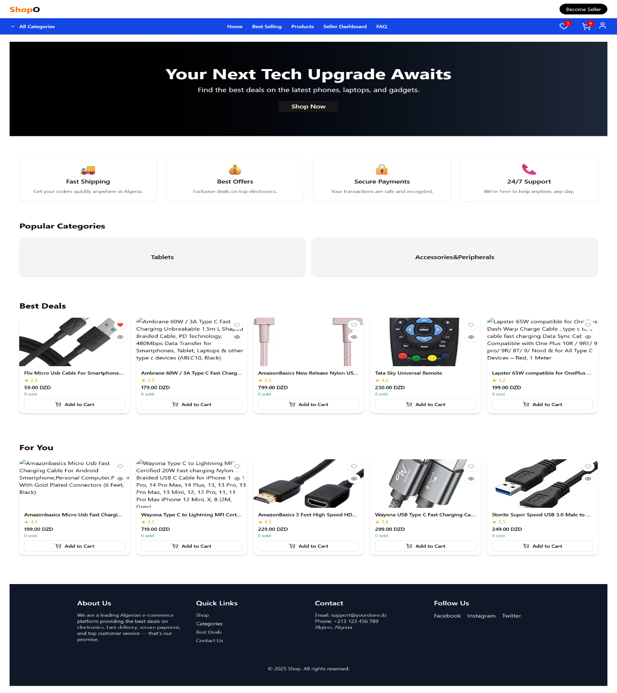
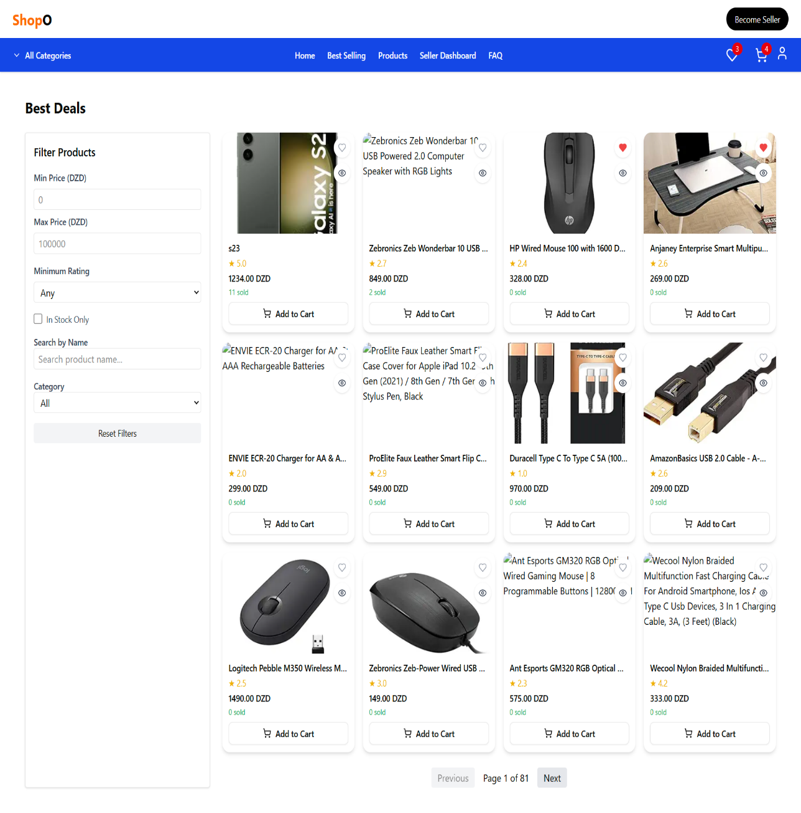
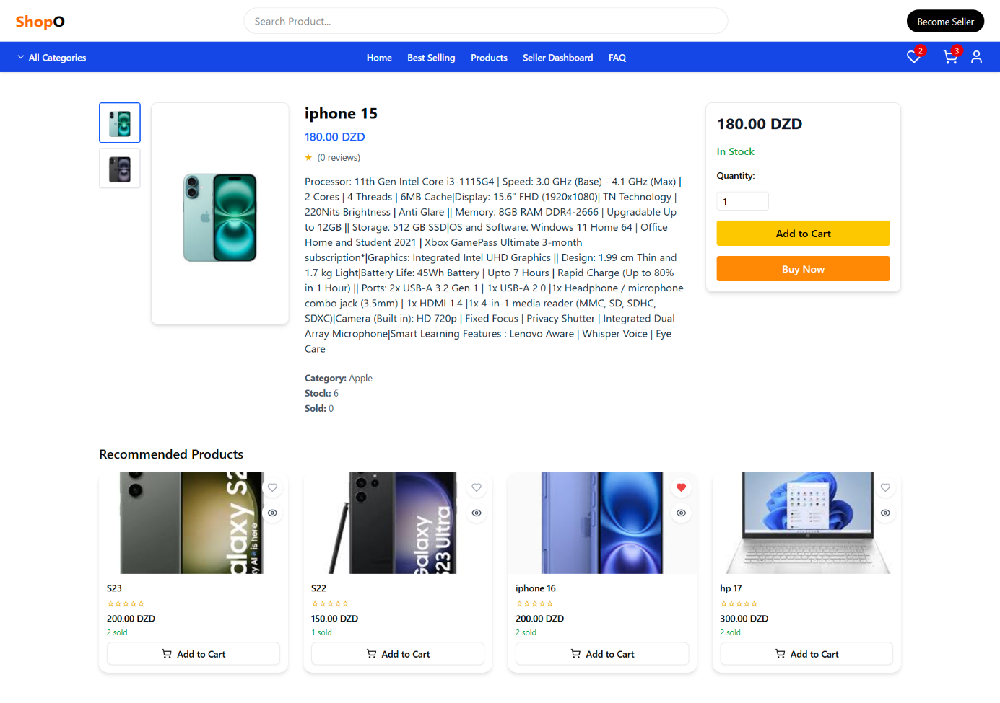
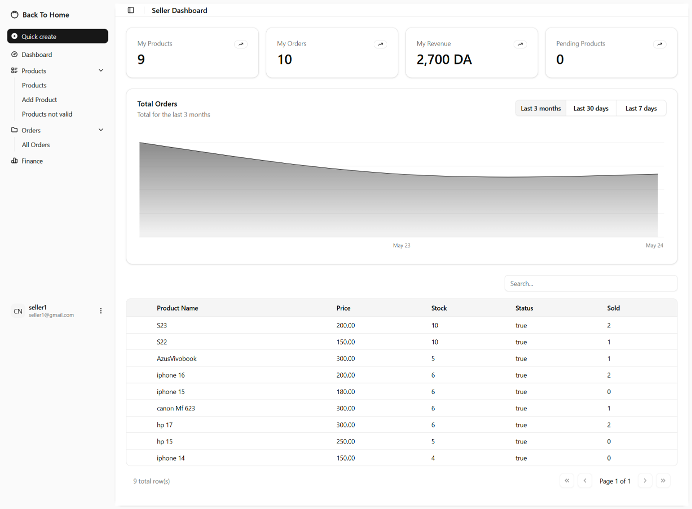
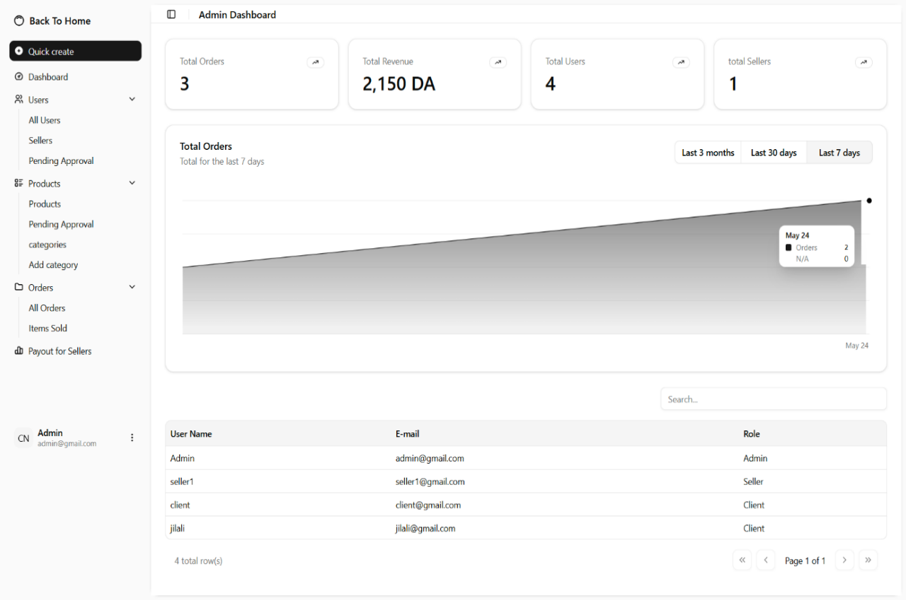
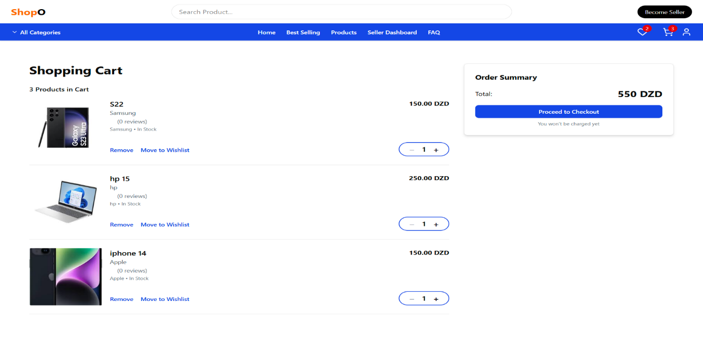
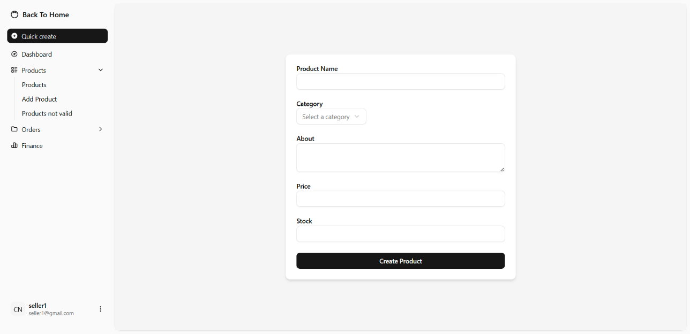
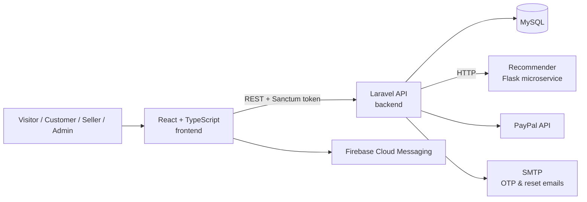
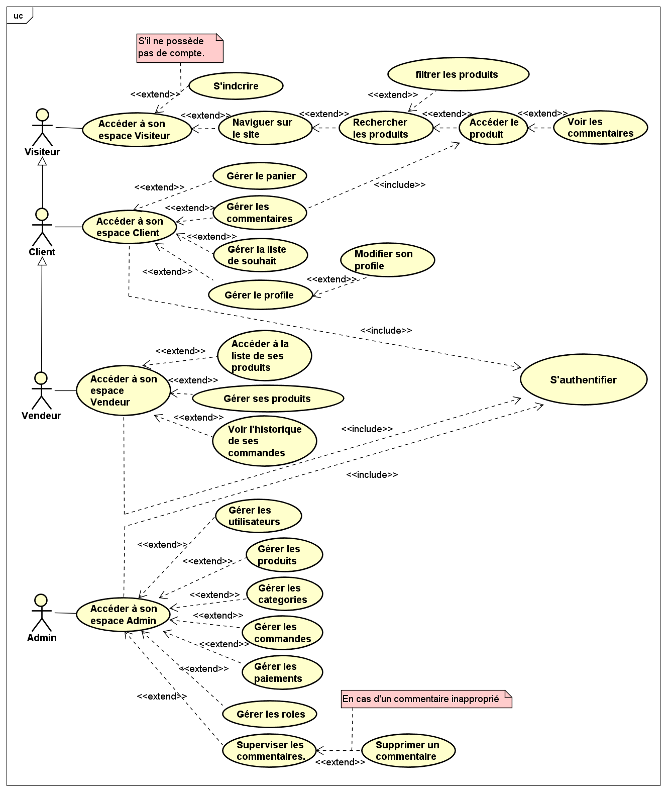
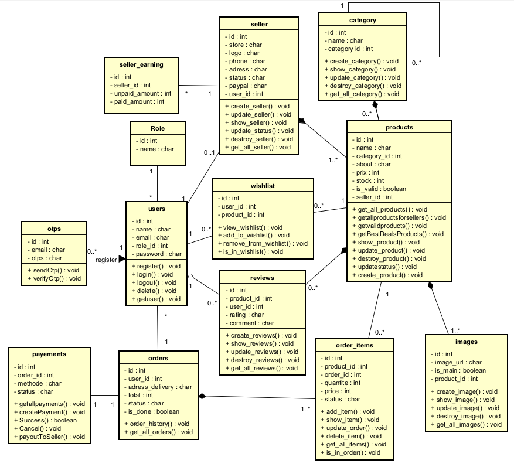

# 🛒 ShopO — Multi-Seller E-Commerce Platform for Electronics


**Bachelor's final project (Licence) — USTHB, Faculty of Computer Science, 2025**
*Design and development of a website for the sale of computer and electronic equipment* · Project ACAD-75 / 2025 · Defended on 15 June 2025



## 🧩 The Problem

Algerian e-commerce is growing fast, but the main platforms leave real gaps: Ouedkniss has no integrated online payment, prices are not always shown and sellers are not verified; Jumia's interface is overloaded with ads. **ShopO** answers these gaps with a clean marketplace dedicated to electronics: verified sellers, prices always visible, ratings, and secure online payment.

## ✨ Features

**Visitors & customers**
- Browse, search and filter products by name, category, price and rating (paginated by 12)
- Sign up with **email OTP verification**, login, password reset
- Product pages with images, stock, reviews and **recommended similar products**
- Wishlist and shopping cart with stock-aware quantities
- Checkout with **PayPal** or **pay on delivery**
- Personal dashboard, profile and feedback to the administrators

**Sellers**
- Apply to become a seller (store name, phone, address) — reviewed by an admin
- Add products with images; each product stays pending until an admin validates it
- Dashboard with products, orders, revenue and a sales chart
- Track orders and payouts

**Administrators**
- Validate products and seller applications, revoke sellers
- Manage users, categories, orders, items sold and reviews (remove inappropriate comments)
- Pay sellers their earnings and read user feedback
- Real-time push notifications when a seller adds a product (Firebase Cloud Messaging)

## 📸 Screenshots

| Products | Product page |
|----------|--------------|
|  |  |

| Seller dashboard | Admin dashboard |
|------------------|-----------------|
|  |  |

| Cart | Add product (seller) |
|------|----------------------|
|  |  |

## 🧠 Recommendation System

A hybrid recommender built in Python and served as a **Flask microservice** ([`backend/recommander_system/recommander.py`](backend/recommander_system/recommander.py)). The data is exported from the database to CSV with Laravel commands, and the approaches were first explored in Jupyter notebooks on real Kaggle datasets.

| Approach | How it works |
|----------|--------------|
| **Popularity-based** | Top 15 products with at least 100 ratings and an average above 3 — for new users |
| **Content-based** | Product descriptions and categories vectorised with `CountVectorizer` (bag-of-words), compared with **cosine similarity** |
| **Collaborative filtering** | Users clustered with **K-Means** on their ratings; the number of clusters is chosen with the elbow method and updated automatically with `KneeLocator`. Products with fewer than 5 ratings and users with fewer than 10 ratings are filtered out |

The Laravel API calls the service and exposes the results through `/api/recommendations/...`.

## 🏗️ Architecture



## 📐 Design (UML)

| Use case diagram | Class diagram |
|------------------|---------------|
|  |  |

Sequence diagrams: [user registration with OTP](docs/uml/sequence-registration.png) · [product added by a seller](docs/uml/sequence-add-product.png)

## 🛠️ Tech Stack

| Layer | Technologies |
|-------|--------------|
| Frontend | React 19, TypeScript, Vite, Tailwind CSS 4, shadcn/ui, React Router, Context API |
| Backend | Laravel 11 (PHP 8.2), Sanctum, Eloquent ORM, role middleware (client / seller / admin), policies |
| Database | MySQL — 15+ tables (users, sellers, products, images, orders, payments, earnings, payouts, reviews…) |
| Data & AI | Python, Flask, pandas, scikit-learn (K-Means, cosine similarity), Jupyter |
| Services | PayPal (sandbox & live), Firebase Cloud Messaging, SMTP emails |
| Tools | VS Code, Git & GitHub, XAMPP, Postman |

## 📂 Repository Structure

```
├── backend/     # Laravel REST API, migrations, seeders, recommender system
├── frontend/    # React + TypeScript single-page application
└── docs/        # Screenshots and UML diagrams
```

- [backend/README.md](backend/README.md) — API setup and endpoint overview
- [frontend/README.md](frontend/README.md) — frontend setup

## 🚀 Quick Start

```bash
# Backend
cd backend
composer install
cp .env.example .env        # configure MySQL, mail and PayPal keys
php artisan key:generate
php artisan migrate --seed
php artisan serve           # http://localhost:8000

# Recommendation service
cd recommander_system
pip install flask pandas scikit-learn kneed requests
python recommander.py       # http://127.0.0.1:5000

# Frontend
cd ../../frontend
npm install
npm run dev                 # http://localhost:5173
```

## 🔭 Future Work

- Delivery tracking and integration with Algerian carriers (Yalidine, EMS)
- Deep-learning recommendations (Word2Vec / BERT embeddings, neural networks)
- Mobile application (Android / iOS)

## 👥 Team

Developed as a team project at USTHB, supervised by **Mr. Abdelnour HIMRANE**.

- **Adel Merad** — Full-stack developer (Laravel API, React frontend, database design) — [GitHub](https://github.com/adelmerad)

## 📄 License

For personal, educational and non-commercial use only — see [backend/LICENCE](backend/LICENCE).
